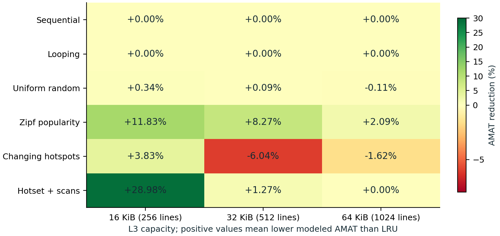
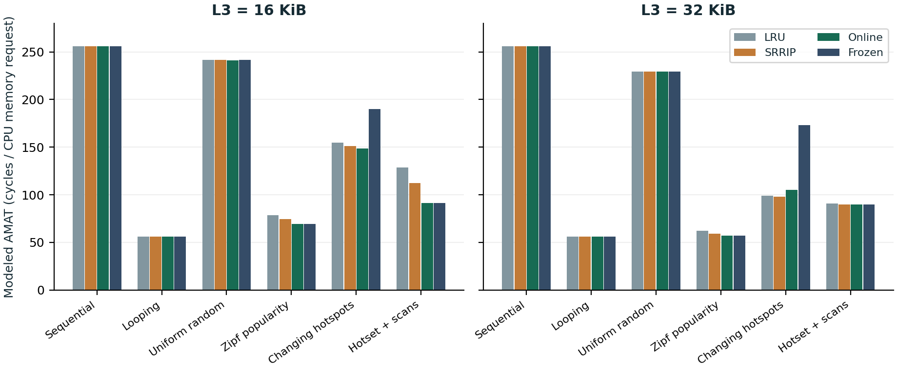
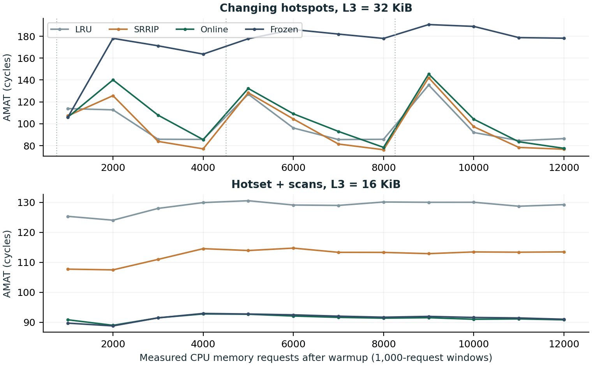
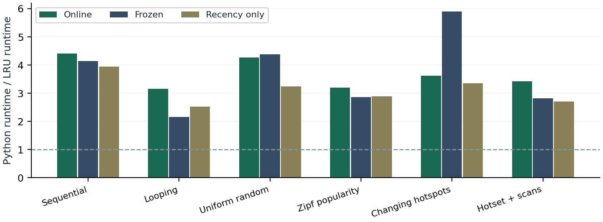

# Online Learning for Adaptive Cache Replacement Under Changing Access Patterns

Research manuscript | November 21, 2026

## Abstract

Fixed cache replacement rules can respond differently to streaming, skewed, and changing memory-access patterns. This study implements a reproducible, trace-driven L1/L2/L3 hierarchy and evaluates a small online logistic reuse predictor at L3. The predictor samples resident lines and learns only after fixed-horizon reuse labels become observable. The evaluation contains 630 simulations: six synthetic read-only workloads, three L3 capacities, five seeds, and seven policies, with 3,000 warmup and 12,000 measured requests per simulation. Across 18 equally weighted workload-capacity cases, online learning changes modeled average memory-access time relative to LRU by a mean reduction of 2.72%, ranging from a 28.98% reduction to a 6.04% increase. It improves 8 cases, ties 7, and regresses in 3. A frozen-model ablation exposes sensitivity to workload shifts. Python runtime increases, and predictor latency is not included in the functional cycle model. The findings support workload-dependent benefits under explicit assumptions, rather than a hardware speedup or a universal improvement.

Keywords: cache replacement; memory hierarchy; online learning; reuse prediction; trace-driven simulation.

## 1 Introduction

A cache stores a subset of memory blocks near the processor. When the requested block is absent and the target set is full, a replacement policy must choose a resident block to evict. The decision matters because a poor eviction can turn a later request into an access to a slower level. Recency and frequency are useful signals, but their value changes with the access stream.

This project investigates the broader theme of self-adaptive memory hierarchies through a deliberately narrow control point: L3 victim selection. L1 and L2 retain fixed LRU policies. Demand misses fill upper levels, while the learner decides which L3 resident to remove. The implementation does not control physical processor caches or migrate operating-system pages.

The research question is whether a lightweight, causally trained reuse predictor can reduce modeled memory-access cost on changing workloads, and what losses and software overhead accompany those decisions. Three hypotheses guide the study: learned reuse helps on skewed or scan-polluted streams; continued learning handles change better than freezing after warmup; and learning introduces measurable runtime and metadata costs.

The contribution is an inspectable experimental artifact, a bounded delayed-label mechanism, and a paired evaluation including failure cases and ablations. Online reuse prediction and adaptive replacement are established research directions. This manuscript does not assert a first-of-its-kind policy or superiority to the state of the art.

## 2 Related Work

Jaleel et al. introduced re-reference interval prediction, including SRRIP and DRRIP, to improve scan and thrashing behavior [1]. The baseline here implements two-bit SRRIP with insertion at value 2, hit promotion to 0, and aging until an eviction candidate reaches 3. DRRIP is not implemented.

Hawkeye learns from a reconstruction of Belady's decisions on past cache accesses [2]. It establishes that learned replacement is not a new problem. Our prototype instead uses fixed-horizon binary reuse labels and a software logistic model; it does not reproduce Hawkeye's predictor, sampling scheme, or hardware design.

LeCaR uses regret minimization to learn between LRU and LFU decisions [3]. Learning Relaxed Belady applies learned replacement in CDN caches [4]. Those studies motivate adaptive policies, but CDN objects and storage workloads differ from fixed-size CPU cache lines. Their published performance numbers are not comparable with this simulator.

ArtMem applies reinforcement learning to tiered-memory page migration [5]. Its operating-system control and migration granularity differ from the cache-line eviction problem evaluated here. Architectural tools such as ChampSim provide a stronger route to studying execution effects [6]. A future architectural comparison would need modern adaptive baselines and real traces, beyond the conventional baselines in this study.

## 3 System Model and Assumptions

Table 1. Scaled cache hierarchy and declared serial lookup costs.

| Component | Capacity | Associativity | Incremental cost |
| --- | --- | --- | --- |
| L1 | 32 lines / 2 KiB | 4-way | 4 cycles |
| L2 | 128 lines / 8 KiB | 8-way | 12 cycles |
| L3 | 256, 512, 1024 lines | 8-way | 40 cycles |
| RAM | All trace addresses | Not modeled | 200 cycles |

The capacities are scaled teaching configurations, and the costs are declared modeling parameters rather than measured latencies. Every line contains 64 bytes. A byte address a maps to block floor(a / 64), and a block maps to set block modulo number_of_sets. Cache ways within that set are the only replacement candidates.

The hierarchy is read-only and non-inclusive: copies may reside at several levels, and eviction at one level does not invalidate another. Each access probes L1, then L2 on an L1 miss, then L3 on an L2 miss, and RAM on an L3 miss. Every missed cache is filled. Functional insertion can occur before downstream lookup because this read-only model has no timing overlap or invalidation dependencies. Independent, fixed upper caches ensure the same LLC reference stream across L3 policies.

```text
AMAT = 4 + 12 m1 + 40 m1 m2 + 200 m1 m2 m3
```

Here m1 is the local L1 miss ratio, m2 is the local L2 miss ratio, and m3 is the local L3 miss ratio. Equivalently, served-by costs are 4, 16, 56, and 256 cycles for L1, L2, L3, and RAM. The implementation accumulates those costs for each measured request. No instruction counts are available, so misses per thousand memory requests must not be described as misses per thousand instructions.

```text
Fill bytes = 64 (L1 fills + L2 fills + L3 fills)
```

Fill traffic counts each transfer between adjacent hierarchy levels: an L2-served request transfers 64 bytes, an L3-served request 128 bytes, and a RAM-served request 192 bytes. It excludes tags, replacement metadata, dirty writebacks, prefetches, bandwidth contention, TLBs, coherence, and page faults. There is no proactive migration or operating-system paging.

## 4 Online Reuse Policy

The predictor's clock advances once per request reaching L3. Before each lookup, one resident line from the requested set is sampled uniformly with a seeded generator. Sampling occurs on both hits and misses, so training is not restricted to evicted lines. Empty sets produce no sample. Snapshot features are computed before updating the requested line's access statistics.

Table 2. Predictor features, with H denoting the reuse horizon.

| Feature | Definition at L3 tick t |
| --- | --- |
| Bias | Constant 1 |
| Recency | min(2, log(1 + age) / log(1 + H)) |
| Decayed frequency | log(1 + f exp(-age / H)) / log(1 + H) |
| Previous interval | min(2, log(1 + gap) / log(1 + H)) |
| Overdue ratio | min(2, age / max(1, gap)) / 2 |
| Resident reuse | 1 if accessed more than once during this residency |

Age is t minus the last access tick. Gap is the interval preceding the latest access, or zero for a new line. Frequency starts at 1 and is updated on a hit as f = f exp(-gap / H) + 1. Counts and intervals reset on reinsertion; no unbounded per-address history is maintained. The main experiment uses H = 256 L3 requests.

```text
p(reuse | x) = 1 / (1 + exp(-w dot x))
```

A snapshot at tick s receives label 1 if its target is referenced in (s, s + H], including the endpoint, and 0 otherwise. Labels are settled only at s + H. Observed requests may mark pending samples positive earlier, but no weight update occurs before the full window closes. Features and the original prediction are saved at sampling time. Prequential Brier and log-loss diagnostics use those saved predictions, and do not evaluate a sample after training on its own outcome.

```text
w[j] <- w[j] - 0.05 ((p_current - y) x[j] + lambda[j] w[j])
```

Weights start at zero. A stochastic gradient step uses the current weights when a label matures; lambda is 0 for the bias and 0.0001 for other weights. The learning rate remains constant to allow continued adaptation. For numerical stability logits are clipped to [-30, 30]. At least 64 weight updates are required before learned eviction; LRU supplies the cold-start fallback.

On an eviction, the policy scores all residents in the requested set and removes the line with minimum reuse probability. Ties use least recency, then block ID. All policies admit every demand miss, so the learned policy is a replacement method rather than a bypass or prefetch controller.

```text
For each LLC reference at tick t:
  mark earlier snapshots of the requested block as reused
  settle snapshots whose endpoint is t; update if enabled
  sample one current resident and save its features
  on hit: refresh resident access statistics
  on full-set miss: evict minimum predicted reuse
  insert the demanded block; retain pending snapshots
```

At most one snapshot is created per tick and every snapshot expires after H ticks. Thus at most H samples and H distinct target IDs are pending. Evicted blocks can remain pending until their labels mature. At trace end incomplete windows are censored, not converted to negative examples. The predictor uses six weights and O(H) pending metadata, plus O(C3) resident statistics; eviction evaluates O(A3 d) feature terms. This is a logical bound, not a measured hardware SRAM budget, and Python object memory is not reported as hardware storage.

## 5 Experimental Method

The declared matrix in configs/paper.json crosses six workloads, L3 capacities of 16, 32, and 64 KiB, seeds 11, 23, 37, 53, 71, and seven policies. Each simulation processes 15,000 requests. The first 3,000 populate caches and train the predictor, and the remaining 12,000 contribute counters and latency. Cache and model state persist across the warmup boundary. Timing-order effects are reduced by reproducibly shuffling policy order within each workload-size-seed combination.

Table 3. Synthetic workload definitions.

| Workload | Exact generator structure |
| --- | --- |
| Sequential | One pass over distinct cache-line addresses |
| Looping | Repeated 192-line loop; seed chooses the base offset |
| Uniform random | Independent uniform references to 4096 lines |
| Zipf | 4096 lines; request weights proportional to rank^-1.15 |
| Changing hotspots | Four equal-length phases; 85% from a disjoint 384-line hotspot, 15% uniform background |
| Hotset + scans | Each 512-request block: 384 random requests to 192 hot lines, then 128 unique scan lines |

LRU, FIFO, resident-lifetime LFU, and two-bit SRRIP are conventional baselines. LFU counts reset when a block is evicted and ties use recency. The online variant uses all six features and continues updating. Frozen uses identical features and warmup training, then disables all weight updates during measurement. Recency uses only the bias and recency feature but retains online updates and the same sampling and label mechanism. The frozen variant still gathers and evaluates labels, so its runtime is not an optimized inference-only deployment.

Every policy receives the identical byte-address trace for its paired seed and workload, verified with SHA-256 hashes. The model receives a current block and cache residents, never the future trace. The horizon and optimizer settings are fixed for the reported matrix; no parameter search or held-out generalization claim is made. Synthetic workloads are fully specified and generated locally. CSV trace import is implemented, but real application traces were not evaluated.

For each workload-capacity pair, the report averages the five seeds. Relative AMAT changes are computed per paired seed before averaging. A deterministic 2,000-resample percentile bootstrap gives exploratory 95% intervals over those seed pairs. Five seeds provide limited uncertainty information. Sequential and looping cases are effectively deterministic, so zero-width intervals do not imply certainty beyond the generator. The overall mean weights all 18 workload-capacity cases equally; it is not a throughput-weighted production estimate.

Complete measured-phase wall time is recorded separately from modeled cycles. Internal timers count scalar prediction and weight-update kernels, but exclude some feature extraction, queue management, and bookkeeping; they must not be treated as total learning overhead. Wall times are single executions per case and seed, with shuffled order, rather than controlled repeated microbenchmarks.

## 6 Results and Analysis

Across the 18 workload-capacity cases, the online policy achieves a mean paired AMAT reduction of 2.72% relative to LRU. It improves 8 cases, ties 7, and increases latency in 3. The range is -6.04% to +28.98% reduction. This arithmetic average includes all cases, including sequential streams, deterministic loops, and negative results. Figure 1 displays the entire matrix rather than selecting only favorable workloads.



Figure 1. Mean paired percentage reduction in modeled AMAT versus LRU across all workloads and L3 capacities. Positive values are improvements; negative values are regressions.

Table 4. Mean modeled cycles and paired reductions at 32 KiB L3.

| Workload | LRU | Online | SRRIP | Online reduction [95% CI] |
| --- | --- | --- | --- | --- |
| Sequential | 256.00 | 256.00 | 256.00 | +0.00% [+0.00, +0.00] |
| Looping | 56.00 | 56.00 | 56.00 | +0.00% [+0.00, +0.00] |
| Uniform random | 229.47 | 229.26 | 229.55 | +0.09% [-0.07, +0.25] |
| Zipf popularity | 62.48 | 57.31 | 59.29 | +8.27% [+7.81, +8.73] |
| Changing hotspots | 99.26 | 105.25 | 98.24 | -6.04% [-7.34, -5.10] |
| Hotset + scans | 91.06 | 89.90 | 89.91 | +1.27% [+1.16, +1.39] |

Table 4 reports mean modeled cycles at 32 KiB L3, with paired seed-bootstrap intervals for the relative reduction. Intervals describe generator-seed variability under this exact setup. They do not account for simulator model error, unseen applications, parameter selection, or hardware costs.



Figure 2. Absolute modeled access cost at 16 and 32 KiB L3, averaged over five seeds. Frozen is the model that stops updating after warmup.

The largest benefit occurs for hotset-plus-scan traffic at 16 KiB: LRU uses 128.67 modeled cycles per request, SRRIP 112.44, and online learning 91.38. The stream combines reusable hot blocks with one-time scan pollution. The result is consistent with the predictor retaining useful residents during scans. It does not establish that every scan-heavy application behaves similarly.

Sequential requests have no reuse, and all policies incur the same 256-cycle served-by-RAM cost. The 192-line loop fits L3 but exceeds L2; after warmup every policy serves it at L3, producing 56 cycles. These controls demonstrate that the learned policy cannot manufacture useful locality. Tiny changes on uniform-random traffic are interpreted as stream-specific variation rather than reliable predictive structure.

At 32 KiB under changing hotspots, online learning uses 105.25 cycles versus LRU's 99.26; the learned policy therefore regresses. A plausible explanation is mismatch between the fixed prediction horizon, resident-lifetime features, and phase transition timing. That explanation is a hypothesis rather than an isolated causal finding, because this study does not perform a horizon sensitivity sweep.



Figure 3. Mean windowed latency for changing hotspots at 32 KiB and hotset-plus-scan traffic at 16 KiB. Dotted vertical lines in the upper panel mark hotspot changes; windows may straddle a boundary.

The frozen policy reaches 173.28 cycles on changing hotspots at 32 KiB, versus 105.25 for continued learning and 99.30 for recency-only learning. Continued updates help relative to this frozen model, yet do not beat LRU. Thus adaptation is useful within the proposed model family, but is insufficient evidence of the best replacement policy.

The feature ablation changes behavior in a workload-dependent way. Full-feature learning performs better on several skewed or scan-polluted cases, while recency alone stays close to LRU in many cases. The complete seven-policy tables, per-seed outcomes, traffic counters, learning diagnostics, and 1,000-request windows are supplied in the machine-readable results, allowing readers to inspect cases omitted from the compact printed table.



Figure 4. Mean measured Python runtime relative to LRU at 32 KiB L3. This is software execution cost in the prototype, not processor cycle cost or physical speedup.

The online-to-LRU mean-runtime ratio ranges from 2.71x to 5.78x across the 18 cases. The implementation pays for sampling, delayed labels, features, prediction, training, and Python object bookkeeping. No conversion between wall time and the synthetic cycle model is justified. Consequently a lower modeled AMAT alone cannot establish a net execution-time benefit after inference and training costs.

## 7 Validation and Reproducibility

Automated tests cover hand-calculated hierarchy outcomes, line offsets and set conflicts, exact victim decisions, warmup exclusion with retained state, endpoint-inclusive delayed labels, censoring, frozen-model behavior, metadata bounds, trace validation, and counter conservation. They also verify that paired policies share trace hashes and identical upper-cache miss counts. These are functional checks of the implementation, not validation of the model against a real processor.

The artifact includes the source, fixed experiment configuration, CSV imports, a local dashboard, raw.csv, summary.csv, benchmark.json, and a manifest containing Python/platform details and SHA-256 hashes of simulator, configuration, and test files. Scientific figures and this manuscript are generated from benchmark.json. A source-stability flag records whether the hashed code changed while the experiment was running.

```text
python -m pytest -q
python -m adaptive_memory benchmark --config configs/paper.json
python -m adaptive_memory report
python -m adaptive_memory serve --port 8765
```

The simulator and dashboard use Python's standard library. Figure and PDF generation require the packages in requirements.txt. Reproductions should use a clean Python environment and record their own timings; numerical cache outcomes are deterministic for a fixed Python implementation, trace, seed, and source version. Floating-point learning implementations on other runtimes may differ slightly.

## 8 Limitations and Future Work

External validity is limited by short synthetic read-only traces, scaled caches, a serial latency model, and five seeds. The model excludes instruction execution, memory-level parallelism, realistic bandwidth, writebacks, coherence, address translation, prefetching, and hardware predictor delays. It cannot support claims about IPC, energy, real page-fault reduction, or operating-system data migration.

The baselines are useful educational references but do not establish state-of-the-art competitiveness. Neither Hawkeye, DRRIP, nor a faithfully reproduced LeCaR variant is evaluated. The learner has no admission control, confidence-based fallback after cold start, explicit phase detector, or net-cost objective. Hyperparameter sensitivity, training-window sensitivity, and sample-rate sensitivity remain untested.

A stronger follow-up would evaluate licensed or publicly distributable application traces, add stronger replacement baselines, sweep horizon and sampling budgets on separate development workloads, measure metadata in a concrete implementation, and evaluate the chosen policy in ChampSim or another architectural simulator. Hardware feasibility would require a specified predictor implementation and accounting for inference latency, energy, and storage. A separate DRAM/CXL or DRAM/SSD page-placement project would need a page migration model and migration-cost experiments.

## 9 Conclusion

A causal online reuse predictor can improve replacement in selected synthetic cache workloads, with the largest observed modeled AMAT reduction of 28.98% relative to LRU. The complete matrix yields only 2.72% mean reduction and includes 3 regressing cases. Continued learning outperforms its frozen counterpart on the reported changing-hotspot example, while conventional policies remain stronger in some configurations. The resulting project is a reproducible functional research prototype. The evidence motivates further evaluation and cost modeling; it does not establish a universally better or hardware-ready memory architecture.

## References

[1] A. Jaleel, K. B. Theobald, S. C. Steely Jr., and J. Emer, 'High Performance Cache Replacement Using Re-Reference Interval Prediction (RRIP),' ISCA, pp. 60-71, 2010. DOI: 10.1145/1815961.1815971. [Source](https://jaleels.org/ajaleel/publications/isca2010-rrip.pdf)

[2] A. Jain and C. Lin, 'Back to the Future: Leveraging Belady's Algorithm for Improved Cache Replacement,' ISCA, pp. 78-89, 2016. DOI: 10.1109/ISCA.2016.17. [Source](https://class.ece.iastate.edu/tyagi/cpre581/papers/ISCA16Belady.pdf)

[3] G. Vietri et al., 'Driving Cache Replacement with ML-based LeCaR,' USENIX HotStorage, 2018. [Source](https://www.usenix.org/conference/hotstorage18/presentation/vietri)

[4] Z. Song, D. S. Berger, K. Li, and W. Lloyd, 'Learning Relaxed Belady for Content Distribution Network Caching,' USENIX NSDI, pp. 529-544, 2020. [Source](https://www.cs.princeton.edu/~wlloyd/papers/lrb-nsdi20.pdf)

[5] X. Yi, H. Du, Y. Wang, J. Zhang, Q. Li, and C. J. Xue, 'ArtMem: Adaptive Migration in Reinforcement Learning-Enabled Tiered Memory,' ISCA, pp. 405-418, 2025. DOI: 10.1145/3695053.3731001. [Source](https://doi.org/10.1145/3695053.3731001)

[6] ChampSim contributors, 'ChampSim documentation,' online project documentation. Accessed November 20, 2026. [Source](https://champsim.github.io/ChampSim/develop/)
